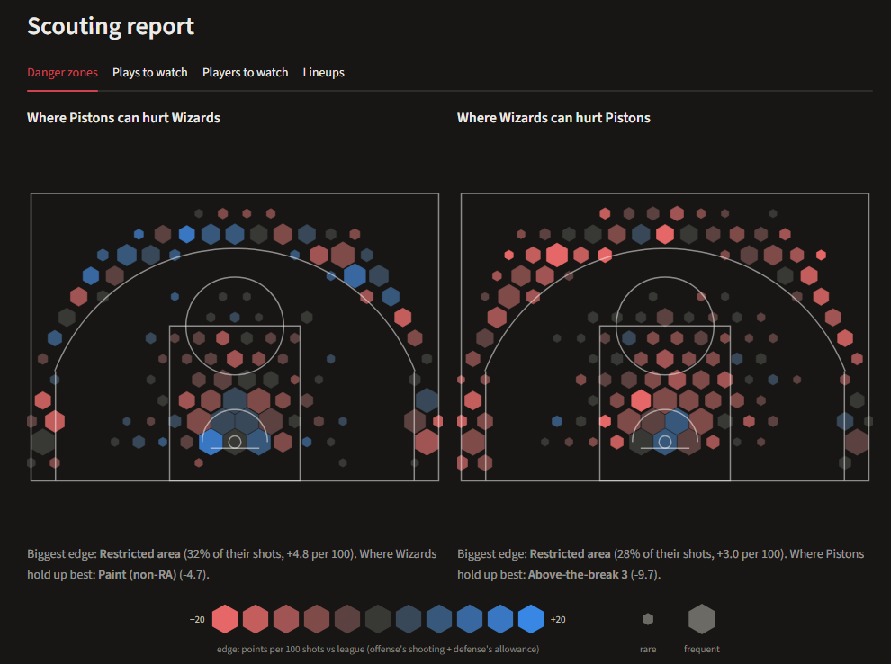
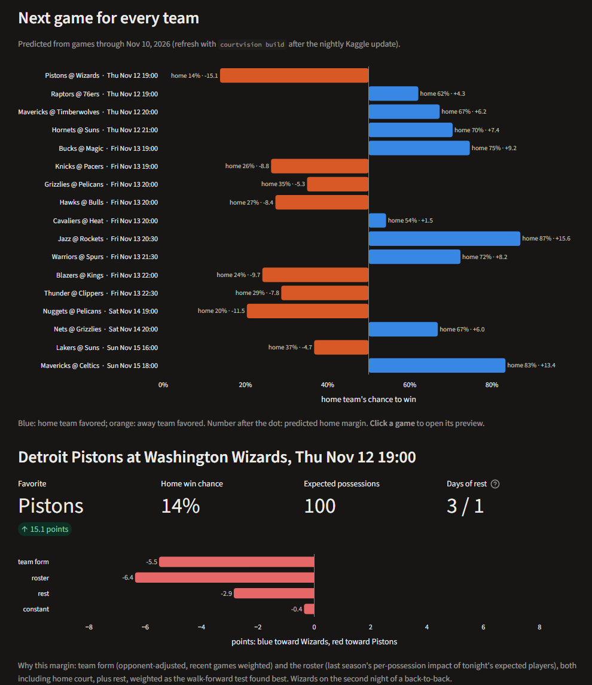
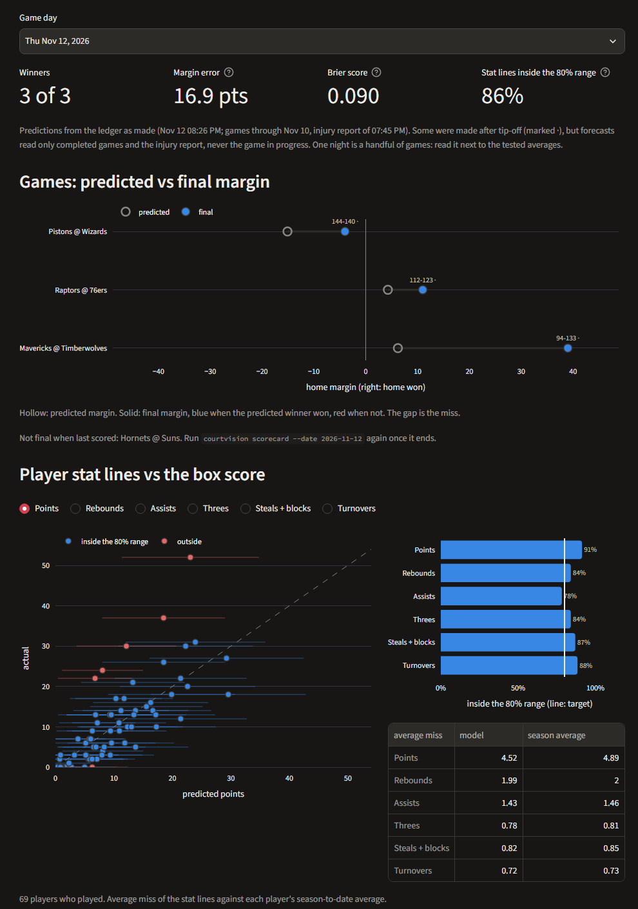
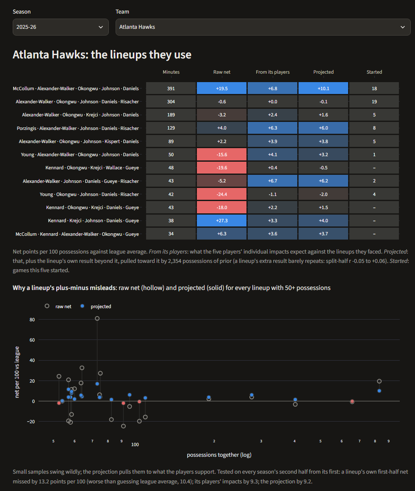
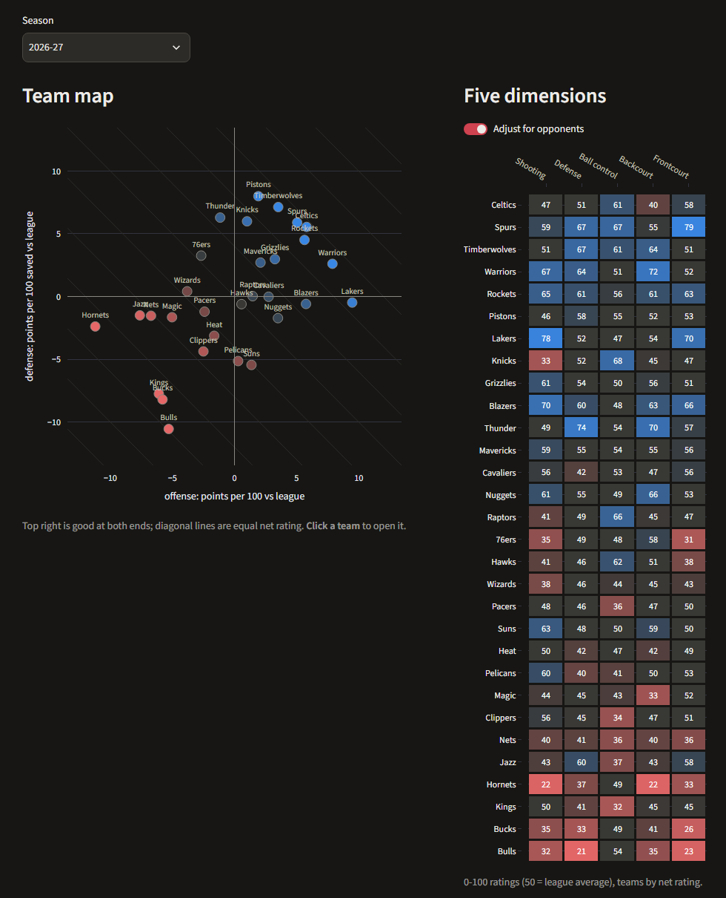

# courtvision

**NBA analytics from public data:** era-adjusted 0–100 ratings, next-game forecasts tested
walk-forward on 6,146 games, and an interactive app with scouting reports, lineups, play
types, coaching analytics and a player market.

**[Open the live app →](https://courtvis.streamlit.app/)**
(demo data: full game-level detail for 2025-26 and this season, season ratings back to
1974-75; if it's been idle, Streamlit takes about a minute to wake it.)



## Highlights

- **Forecasts tested the honest way.** Every game of five seasons (2021-22 to 2025-26)
  predicted a week at a time from earlier games only: **65.8% of winners** (home court
  alone: 55.3%), Brier score 0.214, an average miss of 10.9 points on the margin, and win
  chances within 4 points of the actual rate in every decile. Player stat lines carry 80%
  ranges that held 79–80% of outcomes in seasons not used to set them.
- **A prediction ledger and scorecard.** Every forecast is logged as it was made
  (append-only, with the data, injury report and code version it used), and
  `courtvision scorecard` grades it against the final box score.
- **Ratings that agree with the NBA's own:** the parts add up to NBA.com's net rating
  (r² 0.98, no fitting). Era-adjusted: every season is rated against its own league, from
  1974-75 on. A player's per-possession impact predicts next season's team net rating
  (r 0.77, against 0.38 for raw on/off).
- **Metrics the NBA doesn't publish**, from play-by-play: play types (drives, cuts, lobs,
  step-backs, transition...), hexagon shot maps against the league from the same spots,
  lineup and pair projections, coaching (timeouts that stop runs, tempo control, plays out
  of timeouts), availability from the official injury report, and a market with every
  contract against the cap, tax and aprons.
- **Negative results kept, not hidden:** lineup "chemistry" doesn't repeat (split-half
  r ≈ 0), a lineup's own plus-minus predicts its future worse than assuming league
  average, and coach-vs-coach history and positional matchups add nothing out of sample.
  Each is in [`docs/validation.md`](docs/validation.md).
- **Reproducible:** `courtvision build` rebuilds everything from the raw caches; 109 tests.

**Stack:** Python 3.12 · DuckDB + Parquet · pandas · Streamlit + Plotly · uv · pytest · ruff

<table>
<tr>
<td width="50%"></td>
<td width="50%"></td>
</tr>
<tr>
<td width="50%"></td>
<td width="50%"></td>
</tr>
</table>

## What's inside

Rate and visualize NBA teams, games, and players on a common **0–100 scale**
across six dimensions:

| # | Dimension    | Question it answers |
|---|--------------|---------------------|
| 1 | Shooting     | Are they getting good shots, and making more than they should, by court zone? |
| 2 | Defense      | What shot quality and shot making do they allow by zone; do they force turnovers without fouling? |
| 3 | Ball control | How often do possessions end in a shot rather than a turnover? |
| 4 | Backcourt    | Dimensions 1–3 restricted to guards and perimeter zones |
| 5 | Frontcourt   | Dimensions 1–3 restricted to forwards/centers and the paint |
| 6 | Presence     | How many points per 100 possessions does a player add, adjusted for who he plays with and against? |

Ratings exist at three levels — player → game → team/season — and are always
**era-adjusted**: every number is rated against league average for its own
season, never compared across eras raw. Team ratings also come **opponent-adjusted**.

On top of the ratings, a **player market** prices every player (market comparables:
his rank in value priced at the same rank of veteran salaries), keeps every contract
through 2030-31 with its options, reads each team's payroll against the cap, tax and
aprons, finds where each team is short, lists the players who would fix it (trades,
unsigned players, next summer's free agents) with cost and risk, and projects every
team's cap space next summer. **Forecasts** predict each team's next game: dimension
ratings, every expected player's stat line with an 80% range, the margin and the win
chance, from a model **tested walk-forward** on every game of five seasons (each week
predicted from earlier games only). **Coaching analytics** measure what the NBA doesn't
publish: timeouts that stop runs, plays out of timeouts, tempo control, halftime
adjustments, clutch results, coach vs coach, and each team's margin against what its
roster predicted; every coach metric is tested for whether it follows the coach to a new
team, so you can tell coaching from roster. **Play types** (2015-16 on, from the
play-by-play) break down what every team runs and allows (drives, pull-ups, step-backs,
cuts, lobs, post-ups, transition, putbacks, spot-up threes), how well, who runs each play,
who passes to whom, and how teams turn it over. **Hexagon shot maps** show where a team or
player shoots and how well against the league from the same spots, and every upcoming
game gets a **scouting report**: danger zones, plays to watch, players to watch, lineups.
**Lineups** rank every five a team uses by what to expect from it (its players' impacts
plus its own record, shrunk by how little lineup results repeat), find the best fives a
team could play but hasn't, show which pairs work, and who closes games. Every team and
player page also has the **season-by-season box score** (per game, totals or per 36;
record, points per 100 and pace for teams), each number shaded by where it ranked in the
league that season.

> Status: **v1.8** for every season from 1974-75 (box-score tiers) and 1996-97
> (play-by-play), with a validation report, a visualizer, a live mode, the market,
> walk-forward-tested next-game forecasts, coaching analytics, play types, lineups and
> scouting reports.
>
> * [`docs/metrics_spec.md`](docs/metrics_spec.md): formulas, scaling, roll-ups, tiers, acceptance tests
> * [`docs/validation.md`](docs/validation.md): stabilization, persistence, signal beyond Four Factors
> * [`docs/data_audit.md`](docs/data_audit.md): what's actually in the data, by era

## Data sources

1. **Kaggle** — [`eoinamoore/historical-nba-data-and-player-box-scores`](https://www.kaggle.com/datasets/eoinamoore/historical-nba-data-and-player-box-scores):
   box scores back to 1947 and play-by-play with shot coordinates from 1996-97,
   updated nightly. Every rating is built from it.
2. **[nba_api](https://github.com/swar/nba_api)** — official shot charts, play-by-play
   and rotations (used to validate the Kaggle data and the lineup reconstruction), and
   the live feed for live mode. Requests are rate-limited and every raw response is
   cached to disk.
3. **Kaggle** — [`mrbridge/nba-salary-cap-contracts-2016-2026`](https://www.kaggle.com/datasets/mrbridge/nba-salary-cap-contracts-2016-2026)
   (attribution: MrBridge, mr-bridge.com; research and educational use): player
   salaries (a HoopsHype snapshot of 2026-07-07), payrolls, and cap / tax / apron
   levels. Used only by the market model.
4. **Kaggle** — [`deocheng/nba-data-1946-2026`](https://www.kaggle.com/datasets/deocheng/nba-data-1946-2026)
   (Apache-2.0 on Kaggle; scraped from Basketball-Reference, 17–23 June 2026):
   `public.player_contracts` (every contract's future years and options) and
   `public.coaches` / `public.coach_stats` (who coached each team, and for how many
   games, to assign a coach to every game).
5. **[Basketball-Reference](https://www.basketball-reference.com/contracts/)** team contract
   pages, fetched on request (`courtvision ingest salaries --fetch-current`: 30 pages,
   4 s apart, cached per day, kept on your machine): today's contracts, the newest source;
   and the season's coaches page (`courtvision ingest coaches --fetch-current`: one
   page): this season's head coaches, before the Kaggle records catch up.
6. **[NBA official injury report](https://official.nba.com/nba-injury-report-2026-27-season/)**,
   fetched on request (`courtvision ingest injuries --fetch`: the index page and the newest
   PDF, kept on your machine): who is out, doubtful, questionable or probable for each
   game. Read with the standard library; no PDF dependency.
7. **You** — optional `data/salary_overrides.csv` to correct or add any deal
   (format: [`docs/salary_overrides.example.csv`](docs/salary_overrides.example.csv)).

No player-tracking data is used; none is public.

## Quick start

Requires [uv](https://docs.astral.sh/uv/). [`just`](https://just.systems) is
optional — every recipe is a one-line `uv run` command you can type yourself.

```bash
uv sync
cp .env.example .env                              # then put your Kaggle API token in it
uv run courtvision ingest kaggle                  # download (~1.1 GB) + load (~1 min)
uv run courtvision ingest nba-api --season 2025   # optional: ~1 h cold, for validation (T3, T6)
uv run courtvision metrics build                  # every rating, all seasons (~9 min)
uv run courtvision ingest salaries --fetch-current  # salaries, contracts (today's), cap
uv run courtvision market build                   # value, budgets, needs, options, free agency
uv run courtvision ingest coaches --fetch-current # coach of every game since 1996-97
uv run courtvision coaching                       # coaching analytics (~1 min)
uv run courtvision plays                          # play types, passing, turnovers (~1.5 min)
uv run courtvision lineups                        # fives, pairs, best fives, closers (~30 s)
uv run courtvision walkforward                    # test predictions on 5 seasons (~1 min)
uv run courtvision ingest injuries --fetch         # today's official injury report
uv run courtvision forecast                       # each team's next game (logged to the ledger)
uv run courtvision scorecard --date 2026-11-12    # how a day's predictions fared
uv run courtvision validate                       # regenerate docs/validation.md
uv run courtvision app                            # league / upcoming / scorecard / team / game / player / lineups / plays / coaches / market / live
uv run courtvision live                           # today's games; --game-id X rates one
uv run courtvision demo                           # slim copy for hosting (data/demo/, ~250 MB)
uv run courtvision daily                          # the whole day unattended (below); --dry-run shows the plan
```

`uv run courtvision build` reruns the whole chain from the raw caches.

The [live app](https://courtvis.streamlit.app/) runs the root
`streamlit_app.py` on Streamlit Community Cloud. With no database of its own, it
downloads the `courtvision demo` file from the repo's
[`demo-data` release](https://github.com/adisgill/courtvision/releases/tag/demo-data), and
picks up a newer one within 3 hours of it being uploaded
(`uv run courtvision demo --publish` builds and uploads it, with the GitHub CLI).

**Every day, unattended.** `courtvision daily` scores the past week's unscored days,
forecasts 40 minutes before the day's first tip-off with the latest injury report,
rebuilds once Kaggle's nightly update lands (then re-forecasts the games still to come),
and publishes the demo after each step, logging to `data/logs/`. A forecast never
predicts a game that has started. To run it every morning on Windows (the machine's clock
must be US Eastern, like the schedule; it needs the computer on and signed in, and the
local app closed while it writes):

```powershell
$repo = "C:\path\to\courtvision"
Register-ScheduledTask -TaskName "courtvision daily" `
  -Action (New-ScheduledTaskAction -Execute "$repo\.venv\Scripts\pythonw.exe" -Argument "-m courtvision daily" -WorkingDirectory $repo) `
  -Trigger (New-ScheduledTaskTrigger -Daily -At 9:00AM) `
  -Settings (New-ScheduledTaskSettingsSet -StartWhenAvailable -WakeToRun -AllowStartIfOnBatteries -DontStopIfGoingOnBatteries -ExecutionTimeLimit (New-TimeSpan -Hours 16) -MultipleInstances IgnoreNew)
# Unregister-ScheduledTask -TaskName "courtvision daily" to stop it
```

Then query `data/courtvision.duckdb` with any DuckDB client:

```sql
-- 2025-26 team Defense, best to worst
select team_id, defense_value, defense_rating
from metrics.team_season
where season = 2025 and season_type = 'regular'
order by defense_rating desc;
```

## Data model

| Schema | What | Built by |
|---|---|---|
| `kaggle.*` | one view per Kaggle file, columns untouched | `ingest kaggle-load` |
| `nba_api.*` | `game_log`, `shots`, `pbp`, `rotations`, `shot_zone_league_avg` | `ingest nba-api` |
| `stg.*` | conformed keys (10-char `game_id`, `season`, `season_type`) and documented repairs: `games`, `players`, `player_games`, `team_games`, `pbp`, `shots`, `events` | `ingest kaggle-load` |
| `metrics.*` | possessions, lineups, counts, league baselines, ratings (`team_game`, `team_season`, `player_game`, `player_season`, `presence_season`, `ratings_long`, ...), `player_impact` (per-possession impact), `team_season_adj` (opponent-adjusted), `player_role` (usage); see spec section 7 | `metrics build` |
| `salary.*` | `book` (every contract by season, with options), `contract_summary` (status next summer), `contracts` (July snapshot, NBA ids), `cap`, `min_salaries`, ... | `ingest salaries` |
| `market.*` | `players` (value, price, contract, risk), `teams` (budget, needs, next summer's space), `options`, `fa_class`, `fa_options`, `params` | `market build` |
| `coach.*` | `assignments` (coach of every team-game), `possessions`, `timeouts`, `team_games`, `profiles` (per coach-season and career), `tempo`, `value` (margin vs expectation), `value_reliability` (which metrics are coaching), `h2h` (coach vs coach) | `ingest coaches`, `coaching`, `walkforward` |
| `lineups.*` | `team_stints` (every stint with both fives and the players' expectation), `units` (five-man lineups: raw, expected, projected net, starts, clutch), `pairs`, `tests` (does lineup chemistry repeat; what predicts a lineup), `league` | `lineups` |
| `plays.*` | `shots` (every attempt since 2015-16 with its play type), `league`, `team` (mix and efficiency, offense and defense), `player`, `assists` (passer → scorer), `turnovers` (by kind), `reliability`, `matchup_test` | `plays` |
| `injury.*` | `reports` (every loaded report: game, team, player, status, reason) | `ingest injuries` |
| `forecast.*` | `ledger_games`, `ledger_players`, `ledger_availability` (every prediction as made, append-only), `scorecard_games`, `scorecard_players` (predictions vs results), `availability` (each upcoming game's listed players, what each absence costs), `games` (margin, win chance, rest), `team` (predicted dimensions), `players` (predicted ratings), `player_lines` (stat lines with 80% ranges), `wf_*` (walk-forward predictions and evaluation), `margin_model`, `backtest_*` | `walkforward`, `forecast` |

Parquet under `data/parquet/` is the durable copy; the DuckDB file holds views
over it and rebuilds in seconds. Raw downloads and every nba_api response
(gzipped, with request parameters) are kept under `data/raw/`.

## Layout

```
src/courtvision/   library + CLI (`courtvision ...`)
  ingest/          Kaggle download/load, nba_api client + pull, staging views
  metrics/         play-by-play parser (possessions, lineups), counts, measures, ratings
  app/             Streamlit visualizer: league, upcoming (scouting report), team, game, player,
                   lineups, plays, coaches, market, live; hexagon shot maps
  live.py          live-game ratings from the NBA live feed
  market.py        player value, team budgets and needs, options and risk
  coaching.py      coaching analytics from play-by-play, coach value, coach vs coach
  plays.py         play types, passing connections, turnovers by kind
  lineups.py       five-man units, pairs, projections, best possible fives
  walkforward.py   walk-forward prediction engine (games, player stat lines, ranges)
  forecast.py      each team's next game
  validation.py    generates docs/validation.md
  audit.py         generates docs/audit/*
notebooks/         validation notebook (same numbers as docs/validation.md)
tests/             pytest suite; integration tests run against the built database
docs/              data audit, metric spec, validation, generated audit appendices
data/              gitignored: raw downloads and caches, parquet, courtvision.duckdb
```

## Development

```bash
just lint     # ruff check + format check
just test     # pytest
```

## License

MIT — see [LICENSE](LICENSE). NBA data is subject to its providers' terms;
this repository ships code only, never data.
